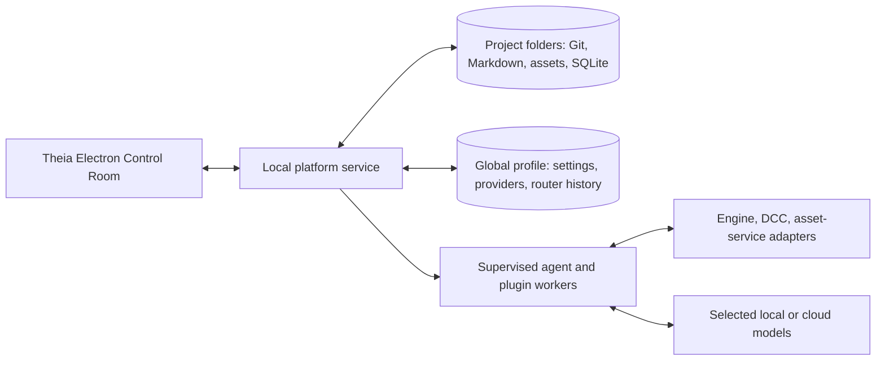

# Technical Architecture: Proposed Stack

**Status:** Complete target-stack recommendation. User-confirmed choices appear in `PLATFORM_DESIGN.md`; other selections here are engineering defaults authorized for best-practice judgment. Which parts exist as tested code is tracked in [DEVELOPMENT_PLAN.md](DEVELOPMENT_PLAN.md); this document is not an implementation claim.  
**Last updated:** 2026-10-26

This describes the complete target system. It is organized by component, not by milestone or release phase.

**Supported desktop systems:** Windows and Linux. Connector availability must be reported per OS. macOS is outside the intended support scope.

**Asset opening boundary:** Project filenames are data, never command text. The Windows default uses a fixed PowerShell literal-path operation with the canonical filename supplied only through the child environment; configured command-interpreter modes are rejected in favor of executable/script-file launch. The opener preserves the existing contained-path checks and reports helper failure without changing the RPC shape. See [the authoring command policy](CONTROL_ROOM_HANDBOOK.md#assets) and [the security remediation record](changes/2026-10-24-security-remediation.md).

**Model hosting:** Connect to cloud providers or separately running local model servers. The desktop installation does not include a model inference runtime.

**Plugin execution:** Executable platform plugins run in separate processes with Windows/Linux operating-system isolation and a central tool broker. Docker or Podman is not required. The selected backends are Windows LPAC/Job Object and Linux bubblewrap, with scoped acceptance in [the managed editor/isolation record](EDITOR_BRIDGE_ACCEPTANCE.md). Landlock/seccomp layering, plugin signatures, host allowlists and the broader adversarial OS/process/network matrix remain open.

**MCP server setup:** The platform can launch a local command, connect to an existing endpoint, or launch a configured local Docker container and connect to its MCP transport. Docker is optional and is not used as a required plugin runtime.

**Agent orchestration:** The local platform service runs a durable scheduler using Project-local SQLite. Supervised worker processes execute agents and tools; no separate workflow server is required.

## Public identity and compatibility

The public name is **PlayWeld**, with `playweld.com` selected by the user. Retaining existing application, package, storage, plugin, and release-feed identifiers is the engineering default for compatibility; see [the identity contract](BRANDING.md). A future identifier migration requires its own design and validation. The [brand asset family](../assets/brand/README.md) supplies the canonical UI mark, favicon, and package icons; website code remains outside this repository rebrand.

## Recommended core stack

| Component | Recommendation | Reason |
| --- | --- | --- |
| Desktop Control Room | Eclipse Theia on Electron; TypeScript and React for custom views | Builds on the selected Theia workbench, editor, terminal, debugging, Git, and extension support. Theia already divides its frontend and Node backend. |
| Platform service | Separate local Node.js/TypeScript process, with a versioned local RPC/event API | Owns durable work independently of the desktop window, including Projects, agents, routing, plugin hosts, settings, backups, and indexes. Supports the chosen window-close setting. No hosted service is required. |
| Agents and tasks | Local service scheduler with a transactional task/event graph in Project SQLite, run by supervised worker processes | Preserves parent/child tasks, board messages, decisions, leases, checkpoints, retries, costs, and validation evidence across crashes or restarts. No separate workflow server is required; concurrency and budgets are settings. |
| Project data | Markdown and game/source/asset files in each Project folder; Project-local SQLite for operational state | Keeps canon portable and reviewable while making discussion, task, and asset metadata queryable. A full folder clone carries its Project state. |
| Global profile | Separate SQLite database plus encrypted credential store | Holds providers/accounts, installed plugins, global settings, and shared router learning outside Project clones. |
| Search | File/code search plus SQLite FTS5 for indexed text; read/write adapters for connected local vector databases such as Qdrant | Source files stay authoritative. The platform writes embeddings and queries them for semantic retrieval; indexes are derived and rebuildable. |
| Asset inspection | Three.js view with glTF/GLB preview derivatives; 2D image viewer | Supports orbit, animation, scene hierarchy, materials, and LOD inspection. Original DCC files remain the source assets. |
| Contracts | TypeScript interfaces with versioned JSON schemas for persisted records and plugin/RPC messages | Gives plugins and connectors a stable, language-neutral boundary. |
| Skills and agent roles | Agent Skills (`SKILL.md`) directories with `gamecrafter-*` metadata; Markdown+frontmatter role packages | Interoperates with the existing skill ecosystem (agentskills.io, skills.sh) and familiar subagent-definition conventions; see [SKILLS_AGENTS_AND_TOOLS.md](SKILLS_AGENTS_AND_TOOLS.md). |

Theia's frontend/backend split and local Electron operation are documented in its [architecture overview](https://theia-ide.org/docs/architecture/). [Theia AI](https://theia-ide.org/docs/theia_ai/) can supply reusable chat, agent, tool, and model UI pieces where they fit, but the platform service should own the persistent recursive swarm, access enforcement, and adaptive model router. Its interfaces should not make our Project and task records depend on Theia internals. Theia AI's documented extension points (agents, prompt fragments, capabilities, tool providers, `AiConfigurationCategory`) fit the in-editor chat and configuration surfaces; its LLM-provider layer is documented as not yet having a fixed contribution point, which is a further reason to keep the model router in the platform service ([Theia AI](https://theia-ide.org/docs/theia_ai/)).

## Process and data boundaries

- The desktop uses a local, authenticated API. Plugins and engine bridges do not receive unrestricted access to that API by default.
- The service records a work request as durable tasks and events. Workers claim tasks, publish findings to the Project board, create child tasks, and checkpoint results. Each side effect is linked to the responsible task, files, tool call, and validation record.
- Confirmed coordination rule: use isolated Git worktrees for independent code/docs work and resource locks for shared live engine or asset operations. A task cannot claim a mutable engine session or asset source already held by another incompatible task. The coordinator validates and resolves conflicts before integration.
- A new Project folder contains its game repository, readable records, Project configuration, Project SQLite database, and local task history. Secrets and shared routing observations stay in the global profile. A clone gets a new Project ID and should reset Git remotes by default. Selected layout (manifest v1): `gamecrafter.project.json` at the root; `docs/` for canon and design records; `game/` for engine files; `.gamecrafter/` for `project.sqlite`, `logs/`, and `cache/` (the database and both directories are excluded from the Project's Git repository; the folder as a whole is what backups and clones copy); `.agents/skills/` for Project-authored skills; a generated `AGENTS.md`.

## Agent, model, and access design

- Model providers implement one common request/stream/tool-use interface. Provider accounts are separate records, so the same provider can have multiple accounts. A model registry captures capabilities, price, limits, and freshness of metadata.
- Local-model connectors point to an independently running endpoint on the user's machine or network. The platform does not install or supervise model-serving engines. Cloud and local endpoints use the same eligibility and routing pipeline, while retaining endpoint-specific capabilities and privacy settings.
- The router first enforces account, agent, task, capability, and user-pool eligibility. It then estimates quality, cost, latency, and reliability from provider data and local outcomes. A small manager model can help classify and rank work but cannot override eligibility. The service records candidate sets, selections, validation, user feedback, and cost for ongoing policy learning.
- The agent runtime uses a compact registry of eligible tools and skills. It loads full instructions/schemas only when chosen and can discover more during a task. Spawned agents inherit the parent's maximum access and receive their own task, context, model, budget, and worker identity.
- A single tool broker applies Full access, Restricted, or Ask always at execution time and logs the decision. Full access permits high-risk actions as requested. Restricted and Ask always require strong boundaries for executable plugins; a plugin running with ordinary host filesystem or network access could bypass a prompt. Game-platform plugins therefore run in supervised, isolated workers with declared capabilities and brokered operations. No Docker or Podman dependency is required. The exact OS isolation mechanism must be chosen and verified for Windows and Linux.
- Theia/VS Code-compatible extensions are a separate runtime with their own privileges. The catalog must show that distinction; our access mode cannot honestly promise to govern arbitrary third-party editor extensions unless their execution is isolated under the same policy.

### Provider accounts, model metadata, and routing

- Provider accounts remain independent profile records, allowing multiple credentials/endpoints for the same provider. First-party adapters cover OpenAI, Gemini Developer API, OpenRouter, xAI, Mistral, DeepSeek, Groq, and Azure OpenAI, while retaining Anthropic and generic OpenAI-compatible endpoints. Account auth is API key and custom headers in the encrypted credential store; OAuth/device login and cloud-native IAM are not included in this selected contract.
- Discovery merges account API metadata with a versioned in-repository catalog sourced to provider documentation. Every populated field carries source, freshness, and confidence; a missing provider field remains `null`/unknown rather than unsupported. Manual non-null values override future discovery; clearing a field to unknown allows a later discovery to refill it. Published prices are estimates, not invoices, and completion probes are never issued silently.
- Azure `providerModelId` is the callable deployment name; `catalogModelId` separately identifies a documented base model. Do not enrich an Azure deployment from a coincidentally identical name: require an explicit base-model ID returned/configured for that deployment.
- The router requires `chat: true` for completion requests and only accepts `true` for required capabilities. Unknown does not widen eligibility. Provider-declared vision is displayed but is not routable while the normalized chat message supports text only; embeddings use the dedicated embedding operation rather than chat routing. High-confidence tags may be applied from exact catalog facts, but the reviewed provider categories do not match builtin role/work-type filters, so those hard restrictions remain empty/unrestricted unless a future sourced rule matches the local taxonomy.

### Agent-to-agent connectivity (A2A)

The loopback gateway bounds authentication attempts before token parsing/credential lookup to 1,200 requests per minute per socket source address. This aggregate ceiling includes valid and invalid requests; after exhaustion even valid credentials receive HTTP 429 until the fixed one-minute window expires. It limits authentication work, while retaining the separate 120-per-minute invalid-token and authenticated-client budgets and existing concurrency controls. Invalid requests below that higher ceiling do not consume an authenticated client's own quota. The source is the actual socket address, not a forwarded header. See the [GitHub security-alert follow-up](changes/2026-10-25-github-security-alerts.md).

- A2A v1.0 is a separate protocol boundary from MCP and the authenticated local JSON-RPC control API. The selected client/server binding is A2A JSON-RPC over HTTP(S) with task streaming; unsupported bindings and auth schemes fail closed. The TypeScript SDK is pinned to a release older than the repository's seven-day dependency-age threshold.
- Outbound A2A Agent Cards are discovered and treated as untrusted data. Connection credentials (static API key, bearer/basic, or custom headers) are encrypted per connection. HTTPS is mandatory for remote endpoints; HTTP is allowed only for explicitly configured loopback endpoints. By default, the `coordinator` role is granted `a2a/*`; other builtin roles do not receive those tools. Brokered send/get/stream/resubscribe/cancel operations use the existing Project access mode, approvals, and audit trail; when invoked within a local Task context, stream updates enter its event channel as bounded `a2a.remote_progress` events. A durable remote-task ledger stores connection/task/context plus Project/local-task/call linkage and status. Get/cancel/resubscribe and send-with-task-ID require a ledger row owned by the calling Project; `a2a/list-remote-tasks` is likewise Project-scoped. Possession of a remote task ID alone conveys no authority. Redirects and cross-origin advertised interfaces cannot receive configured credentials. An interrupted send before a remote task ID is returned cannot be automatically reconciled or retried.
- The optional inbound gateway uses a separate HTTP listener bound only to `127.0.0.1`, never the control API or a wildcard/LAN address. It authenticates revocable one-time-issued bearer tokens stored only as hashes and authorizes every operation against explicit Project/role/task grants. It exposes only task create/get/continue/stream/cancel via the durable TaskService; task records returned after create or failed-task retry are revalidated after deduplication so Project, role, A2A client owner, and context remain within the grant. A2A continuation cannot approve a broker request. Strict Host/Origin checks, no permissive CORS, separate unauthenticated Agent Card limits, authenticated per-client rate/concurrency limits, and active-stream termination on token/grant changes apply. Public/LAN exposure, OAuth/OIDC, gRPC, webhooks, and administrative RPC are outside the selected scope.

## Typed decision assistance

Engineering default informed by the [decision-model investigation](research/decision-models-and-task-policy.md) and [routing-system comparison](research/local-model-routing-systems.md): integrate a separately running typed decision endpoint rather than bundle an inference engine or replace the router with a general coordinator model. The service's [assessment contract](../packages/contracts/src/models/decisions.ts) separates uncertain judgments from task-completion evidence and validated router outcomes.

- **Shadow:** record classification, effort, missing-context, review, decomposition, engine-validation advice, and a candidate recommendation; leave dispatch and agent instructions unchanged. The default is shadow with empty account/model settings, so there are no calls until configured.
- **Assist:** explicit opt-in permits sufficiently concentrated candidate advice to influence model selection and adds bounded task advice to the agent's pinned context. Eligibility, account/model enablement, pool intersections, declared capabilities, estimated budget/latency filters, and manual selection remain authoritative at preparation time. Advice never changes task type, permissions, dependencies, completion requirements, or review authority.
- **Off:** make no assessment request. Outage, denial, malformed output, insufficient probability/margin, reported context truncation or collapsed options, and configuration changes retain the ordinary router policy. These are regression-tested transport/dispatch boundaries, not evidence of a model's decision accuracy.

### Configuration and ownership

Use Models & Routing to add a dedicated OpenAI-compatible provider account pointing to the separately running decision server. The account ID is visible in the account table; credentials use the existing encrypted store. Do not discover/add the decision checkpoint to worker pools unless it separately supports the worker's chat/tool protocol. The typed adapter does not use provider discovery or ordinary chat completion to call the judge.

Configure these Models settings at platform or Project scope:

| Setting | Meaning and default |
| --- | --- |
| `models.decisions.mode` | `shadow` by default; `off` or explicit `assist` |
| `models.decisions.accountId` | Account ID; empty disables calls |
| `models.decisions.model` | Explicit decision checkpoint/version; empty disables calls |
| `models.decisions.protocol` | `systemone` by default; optionally `openrouter-decisions` |
| `models.decisions.allowRemote` | False; non-loopback inference requires opt-in and HTTPS |
| `models.decisions.timeoutMs` | 3,000 ms complete-response deadline, no automatic retries |
| `models.decisions.minProbability` | 0.9 selected-option/yes probability; not the provider confidence field |
| `models.decisions.minMargin` | 0.2 selected-option versus runner-up margin for model advice |

For a local System One server, use an account base URL such as `http://127.0.0.1:9001` or `http://127.0.0.1:9001/v1`; the adapter posts to `/v1/systemone`. OpenRouter Decisions expects `https://openrouter.ai` or `https://openrouter.ai/api`, an OpenRouter credential, explicit remote consent, and an appropriate decision-model identifier. A network-hosted local server is also non-loopback; plain HTTP on another machine is intentionally rejected. Provider access is still governed by the paid-effect broker policy, including Ask always approvals; a refused optional assessment does not block ordinary eligible model routing.

The service requests an eligible-candidate preview without persisting a worker selection or consuming exploration. Short `m0`, `m1`, ... option labels correspond to the ordered candidate snapshot, avoiding long-ID collisions in small encoder option budgets. Only returned known labels with the configured probability and margin can produce a suggestion. Thresholds do not establish calibration; task-quality comparisons and locked evaluations remain Verify.

Agents assess once for a task loop and checkpoint the assessment identity. Matching task/state/configuration records are reused without recharging their reported usage; identical in-flight requests are coalesced. This is not an exactly-once paid-operation guarantee across process crashes. Fresh decision usage contributes to task token/cost spending separately from worker completion. Requests are capped at 64 KiB, responses at 1 MiB, and cancellation/deadlines cover body reads. Summaries and eligible metadata are supplied to the endpoint; the dedicated history stores their hash rather than a copy of task text or credentials. Existing broker logs/task records retain their ordinary audit inputs. A hosted judge cannot be the sole privacy gate for its own input disclosure.

Versioned assessments live in the profile database, scoped by Project/task, with service-owned `decision.assessment` events in Project history. Audit Model Usage merges that ledger as a separate `decision` source with nullable input/output/cache counts; existing `completion` count fields retain their non-null contract. Unknown counts are not fabricated zeroes and unknown charges are not free. The read-only Models & Routing assessment tab shows baseline versus suggested model, advice, nullable usage/cost, latency, and structured details. Assessment requests and history params/results explicitly require `schemaVersion: 1`. The authenticated `decisions/assess` RPC uses the same broker boundary; `decisions/history` is read-only. Profile migration 15 adds the history table without changing existing tasks, outcomes, or credentials. Project clones retain their historical events, but do not copy the profile's detailed assessment index.

Source and automated fake-endpoint evidence: [transport tests](../packages/platform-service/src/models/decision-provider.test.ts), [assessment tests](../packages/platform-service/src/models/decision-service.test.ts), [router boundary tests](../packages/platform-service/src/models/router.test.ts), [worker/RPC integration tests](../packages/platform-service/src/models/models.integration.test.ts), and [UI view-model tests](../packages/theia-control-room/src/common/models-view-model.test.ts). No Kev/Laya weights, live Jev request, measured routing improvement, trained PlayWeld classifier, or calibrated deployment is established by these tests. LLMRouter/RouteLLM/vLLM adapters and counterfactual evaluation pipelines remain possible extensions, not shipped dependencies.

## Plugin and connector contract

The unified Plugins catalog shows both coding extensions and platform plugins. Native game-platform plugins use a versioned manifest declaring entry points, contributed module/genre/agent/skill/tool/UI types, compatible versions, settings schema, dependencies, requested capabilities, and migrations. Runtime plugin code runs out of the main UI process. UI additions use registered extension points or declarative panels so community packages do not need to rebuild Theia. Theia's [extension model](https://theia-ide.org/docs/extensions/) distinguishes compiled Theia extensions from installable compatible extensions; the platform plugin API is our own contract.

Engine and DCC connectors implement capability discovery, connection status, read/inspect, apply, and validate operations. Unity, Unreal, and Godot connectors use CLI and/or MCP. Other authoring and generation services use their actual supported MCP, CLI, or API surface. Adapters expose engine-specific actions without pretending Unity, Unreal, and Godot have identical capabilities. Meshy, Tripo3D, and similar services use the same asset job lifecycle: request, status, result, license/provenance, review, import, and validation. The source asset remains intact; preview conversion creates derived glTF/GLB where needed. [Three.js GLTFLoader](https://threejs.org/docs/pages/GLTFLoader.html) supports the preview format.

**Chosen engine boundary:** use CLI and MCP connectors. Each connector reports its actual engine process or MCP session, Project identity when available, engine version, readiness, supported operations, and validation evidence. The platform must distinguish file/CLI access from a verified live editor connection and must not claim editor actions that its connector cannot perform. In-editor companion plugins may be considered as a later expansion of the connector system, but are not required by the current design.

Engine test acceptance uses structured completion evidence in addition to process status: Unity NUnit XML and Unreal Automation JSON must contain successful, completed non-empty tests with consistent counts. The [live Windows acceptance record](LIVE_ENGINE_ACCEPTANCE.md) covers selected Unity 6000.6.0f1 and Unreal 5.8.3 fixtures, approvals, packaging and built-player assertions. CLI tool versions and editor versions remain distinct; [Extended acceptance](EXTENDED_ENGINE_ACCEPTANCE.md) adds official Unity live identity and screenshot collection, Windows/Linux/WebGL rendering/audio, browser input, Unreal editor bridge calls and adapted brokered screenshots, and Linux commandlet startup. File-backed screenshots are collected only within the current Project; screenshots without an image artifact fail. Other versions/targets, production Projects and remaining bridge bindings stay Verify.

**MCP connection manager:** store each server's launch or endpoint definition in organized settings, with platform/Project scope and effective configuration shown. For a Docker-launched server, configure image reference, command, transport, mounts, environment/secrets, startup/stop behavior, and connection health. The platform starts and supervises only containers it launched; it can also connect to a user-managed server endpoint. The tool broker applies agent access rules to MCP calls, while container mounts and network privileges are shown as part of that server's capabilities. Support MCP transport/version negotiation across revisions 2025-03-26 through 2026-07-28 instead of hard-coding one; the 2026-07-28 revision removes protocol sessions and the initialize handshake, adds `server/discover`, and deprecates Roots, Sampling, and Logging, while many community engine/DCC servers still implement the older handshake ([MCP changelog](https://modelcontextprotocol.io/specification/latest/changelog)). Docker's [run command](https://docs.docker.com/reference/cli/docker/container/run) supports container input/output, mounts, and environment configuration; the MCP [TypeScript SDK](https://ts.sdk.modelcontextprotocol.io/) supports standard stdio and Streamable HTTP transports.

## Storage, backup, and recovery

Canon and design remain Markdown in Git. Agents write new durable knowledge to those reviewable files or structured Project records; they do not create vector-only canon. Project SQLite stores structured operational data, references, task/board history, and indexes. SQLite [FTS5](https://www.sqlite.org/fts5.html) indexes text. Vector storage is selectable: embedded LanceDB, lightweight SQLite exact cosine search, PlayWeld-managed native Qdrant, an existing local Qdrant service, or a remote Qdrant endpoint. Backend and deployment are distinct settings. Each adapter must enforce a Project namespace, idempotent upsert, deletion, dimension/version checks, and backend-neutral filtered retrieval. The indexing service records destination identity with vector mappings and re-embeds unchanged sources when the destination changes. Old destinations are retained rather than deleted during a backend switch. Markdown and source files remain authoritative and indexes are rebuildable. See [vector storage research](research/vector-storage-options.md).

Embedded indexes live under `.gamecrafter/vectors.lancedb/` or `.gamecrafter/vectors.sqlite`; managed Qdrant stores data under `.gamecrafter/qdrant/`. A single platform service owns local handles and managed processes, closing them during shutdown. Cached handles for previous settings remain owned until service shutdown, avoiding closing a database during an in-flight read. Database directories must not be copied as a consistent live backup without quiescing or a backend snapshot; rebuilding derived indexes after clone/restore remains the conservative path. No vector-only authored knowledge is permitted.

Explicit remote mode requires HTTPS and `knowledge.vectorStore.allowRemote`; it sends embeddings and source metadata, not source chunk text in Qdrant payloads. Legacy `qdrant` configurations without deployment retain external-endpoint behavior, including their prior transport policy; users should migrate remote URLs to explicit remote mode. Credentials remain profile-encrypted references. Managed Qdrant uses a private API key, loopback REST, no unused gRPC/CORS/cluster/telemetry, a pinned binary prepared at package-build time, and version-checked readiness. The local control API remains OS-native IPC, not the Qdrant HTTP endpoint.

Additional backends can register trusted service adapters through `PlatformServiceOptions.knowledgeVectorStoreAdapters`. Registration rejects duplicate IDs and unsupported deployments. This is not a marketplace-plugin runtime contribution: executing third-party adapter code through the isolated plugin protocol and publishing adapter capability discovery remain open.

Built-in adapters check mapped point presence during reconciliation, so missing vector data is regenerated without requiring source edits. Failed deletions retain mappings for a subsequent reconciliation retry. Derived vector directories are excluded from Project Git and clone copies; cloned Projects rebuild their own indexes. Configuration saves use the existing atomic settings-import transaction, and settings changes during an index task cause another pass. Legacy external endpoints still require HTTPS whenever a credential would otherwise traverse non-loopback HTTP. Registered non-HTTP adapters must supply their own connection validation while explicit remote consent remains enforced by the registry.

Backup jobs snapshot either whole Project folders or the separate global profile, with destination plugins for local, FTP, S3, Google Drive, and others. Both scopes are encrypted by default with a user-controlled recovery secret stored separately from backup archives. A backup manifest records content hashes, schema/plugin versions, and restore requirements. Restore goes to a new location first for verification and can then be selected as the active Project/profile. Recommended settings include manual and scheduled runs, retention rules, compression, integrity checks, and optional incremental archives. Use a maintained authenticated-encryption library and password-based key derivation; do not invent a new archive cipher or store the recovery secret with the archive.

## SQLite health diagnostics and migration compatibility

Selected engineering default for W05, 2026-10-25: diagnose an explicitly selected profile or Project SQLite file through the database seam without starting the daemon, applying migrations, repairing records or substituting a new empty store. The CLI `doctor --database <absolute-path> --kind <profile|project>` emits schema-versioned JSON with fixed guidance and no raw SQLite errors, record values, migration names or filesystem paths. A single read transaction checks structural integrity, foreign keys, a recognized applied migration prefix and the selected database kind's core markers. Current profile/Project migration targets remain 21/14; they are distinct from the report's schemaVersion 1.

Statuses distinguish healthy, readable but upgrade-required, missing, uninitialized, incompatible, corrupt/integrity-failed and unavailable. Exit 0 covers healthy/upgrade-required, exit 1 covers a valid invocation with an unhealthy/unavailable result, and exit 2 covers argument errors. A foreign-key failure does not imply physical page corruption; the report keeps the check outcomes separate. Empty/unrecognized files are never treated as healthy. Results do not prove every application invariant, backup authenticity or credential decryptability. Reports are returned to the operator, not automatically persisted as a new audit ledger.

Before migration SQL or profile snapshot creation/retention, validate the complete recorded history against the application's ordered definitions. Reject future IDs, gaps, renamed entries, malformed histories and unrelated existing schemas rather than applying missing older migrations or initializing metadata over existing tables. Known valid older prefixes retain the existing forward upgrade behavior. A profile-bootstrap failure releases its database handle; existing Project database failure handling also closes its handle. Profile snapshots retain their existing policy. The Project-specific snapshot guard below adds recovery files before registered Project upgrades; neither policy provides transactional rollback across all migrations or in-place salvage.

The diagnostic uses a SQLite read-only connection, skips journal-mode changes and does not force checkpoints. SQLite may create/update WAL coordination files even for read-only readers; keep database/WAL/journal evidence together and stop the owner before collecting a recovery copy ([SQLite WAL rules](https://www.sqlite.org/wal.html#read_only_databases)). Structural validation uses [integrity_check](https://www.sqlite.org/pragma.html#pragma_integrity_check), with a separate foreign-key query and bounded returned diagnostics. Scanning a large file can still be expensive; no large-history resource qualification is implied. A locked, inaccessible or otherwise unreadable file fails unavailable rather than authorizing repair. Automatic database quarantine/repair, broader verified recovery and extra domain-ledger retention remain separate open work. The knowledge lexical-index recovery below covers only a disposable FTS index. See the [operator runbook](RECOVERY_RUNBOOK.md#diagnose-a-database-without-starting-the-service) and [implementation record](changes/2026-10-25-sqlite-health-diagnostics.md).

## Project pre-migration recovery snapshots

Selected engineering default for W05, 2026-10-26: opening an existing, registered Project database at a recognized older migration version first publishes a fresh verified SQLite recovery snapshot. `ProjectDatabases` uses the existing database seam's `VACUUM INTO` snapshot operation, which captures committed WAL content consistently ([SQLite documentation](https://www.sqlite.org/lang_vacuum.html#vacuuminto)). This is separate from the existing profile snapshot policy, which is unchanged.

The Project snapshot path is `.gamecrafter/pre-migration/project-v<old>-to-v<target>-<uuid>.sqlite`. Each attempt writes a uniquely named `.partial` file, restricts its mode where supported, flushes it, then opens it read-only to check SQLite integrity, foreign keys, the recognized old migration prefix and matching Project identity. Only after validation and handle closure is the file renamed to its published `.sqlite` name and migration allowed to start. Windows flushing uses a non-truncating writable handle to this attempt's own temporary file. Any creation, flush, verification or publication failure stops the upgrade and releases the live database handle. Only that attempt's partial file is eligible for best-effort cleanup; a crash may leave a partial file, which is never selected or reused automatically.

New/uninitialized and already-current stores do not create snapshots. Incompatible history and wrong Project identity are rejected before creating recovery files. Failed migration SQL leaves its published snapshot available; retries capture fresh state under a new name, never reuse earlier snapshots and never prune them. Individual migrations retain their existing transaction semantics; this is not whole-upgrade automatic rollback. The filename describes the attempted target, not a successful upgrade.

Recovery directories reject a symlink/junction at the snapshot-directory boundary and contain a canonical `*` ignore file, protecting registered Projects whose root ignore rules have not yet been refreshed. Existing conflicting ignore rules stop the upgrade rather than being overwritten. Project create/open ignore rules also exclude this directory, and clone omits source recovery files because they retain the source identity and historical state. These checks are not a hostile-filesystem race sandbox; do not share a Project database between service owners. Existing backups retain their whole-Project file behavior, including recovery files; no archive format or backup exclusion policy changes here.

Snapshots are local plaintext database copies, not encrypted full-Project backups. They do not contain authoritative game/canon files or provide an automatic restore, encryption, signing, physical-disk durability certification or exhaustive semantic validation. Filesystem permissions on Windows follow the user's existing ACLs. Keep verified encrypted backups and diagnose an independent recovery copy with the read-only doctor; never replace an active database in place. Automatic snapshot retention/deletion and broader corruption recovery remain open. See the [operator procedure](RECOVERY_RUNBOOK.md#preserve-and-inspect-a-project-pre-migration-snapshot).

## Knowledge lexical-index recovery

Selected engineering default for W05/R04: full knowledge rebuilds and reconciliations validate the external-content `knowledge_chunks_fts` index against `knowledge_chunks` before applying source changes. An FTS-specific `SQLITE_CORRUPT_VTAB` consistency failure triggers SQLite's FTS5 rebuild command and a second integrity check, all in one immediate transaction. Failure rolls the transaction back; lock, I/O, missing-schema and general database corruption errors do not authorize rebuilding. A healthy index is checked without rebuilding. This uses SQLite's documented [external-content integrity check](https://www.sqlite.org/fts5.html#the_integrity_check_command) and [rebuild operation](https://www.sqlite.org/fts5.html#the_rebuild_command).

Only the disposable lexical index is rebuilt from its existing chunk table. Authored files, canon records, task/event history, embedding profiles and vector mappings are preserved. This is a write operation through the existing supervised indexing/broker path, separate from the read-only database doctor. Full requests cannot reuse an incremental-only task; a full request encountering an active indexer waits and then performs its own full check. The tool output includes `lexicalIndexRebuilt`; a repaired run reports `noOp: false`, updates its full-reconcile time, and retains a rebuild statement in the task result summary. Subsequent healthy full checks retain no-op behavior when sources are unchanged. Incremental watcher runs do not scan/repair FTS.

The scope is an existing FTS5 table whose indexed entries are inconsistent with readable chunk content. Missing tables/triggers, physical database damage, corrupt chunk/canon rows, board FTS, vector-store recovery and whole-database salvage remain outside this slice. Preserve originals and verified backups before recovery; a successful lexical repair does not qualify all database semantics, remote vector backends, large-history performance or installed-product recovery. See the [operator workflow](RECOVERY_RUNBOOK.md#rebuild-an-index-and-validate-the-result).

## Engineering defaults for remaining technology choices

- **Repository layout:** one TypeScript monorepo (this repository) holds the design documents, the Theia app (`apps/control-room`, plus a development-only browser target), the platform service, shared contracts, the service client, and later the plugin SDK and first-party connectors under `packages/`. Keep Project files independent of the platform source repository. Publish versioned plugin contracts and migration rules.
- **Toolchain (selected 2026-09-28):** Node 24 (Theia 1.75 requires `>=24`; Electron 42 bundles Node 24), npm workspaces (Theia itself moved from yarn to npm) with Turborepo for task orchestration, TypeScript 5.9 with strict CommonJS output, Vitest for tests, ESLint + Prettier. Theia packages are pinned to one exact version (`1.75.0`, Electron `42.11.18`, React 19 as Theia's peer dependency). Dependencies are pinned exactly and preferred when published at least seven days earlier.
- **SQLite:** `node:sqlite` (`DatabaseSync`; SQLite 3.53 with FTS5 and JSON1 confirmed present) behind one small `Database` seam in the platform service so a native module such as `better-sqlite3` can replace it if the module's release-candidate status becomes a problem. No native SQLite dependency is bundled.
- **Contracts:** TypeBox schemas with derived TypeScript types, validated with Ajv. Every persisted record and RPC message carries a `schemaVersion`; IDs are UUIDv7 so they sort by time in SQLite.
- **Local API:** JSON-RPC 2.0 (`vscode-jsonrpc`) over a local-only, OS-native IPC endpoint: a Unix domain socket under `$XDG_RUNTIME_DIR/gamecrafter/` (fallback under the profile directory) on Linux and a per-profile named pipe on Windows. A per-install random token stored with owner-only permissions in the profile directory must be presented in the first request (`session/hello`, which also negotiates the protocol version) or the connection is closed. Workers and plugins reach Projects and tools through service-issued capabilities. The control API is never bound to a TCP interface.
- **Theia integration boundary:** the Theia backend hosts one bridge that discovers the running service (or starts it) through the service client and exposes a frontend-facing proxy; Theia frontend code never touches sockets, files, or SQLite. Git, merge-conflict handling, themes, and language basics come from the VS Code builtin plugins downloaded at build time (`@theia/git` is no longer published); the Project Home view is the landing surface instead of Theia's Welcome page.
- **Plugin languages:** publish a TypeScript SDK over a language-neutral process protocol. Permit Python and native executable workers through the same protocol, so DCC-specific integrations do not require a Node rewrite. Use registered UI extension points rather than allowing marketplace plugins to alter Theia internals directly.
- **Skills and roles:** ship a curated 30-skill first-party game-development library as platform-service build assets, enabled by default with per-Project controls; use bounded `skills/read-resource` RPC/broker reads and the Control Room reference reader for progressive disclosure; see [library guide](GAME_DEVELOPMENT_SKILLS.md). Adopt the Agent Skills open format for installable skills and a Markdown-plus-frontmatter role package; use three-tier progressive disclosure through a broker `activate_skill` tool; accept every source form the `skills` CLI accepts; details in [SKILLS_AGENTS_AND_TOOLS.md](SKILLS_AGENTS_AND_TOOLS.md).
- **Settings:** typed schemas with validation, migrations, and platform → Project → applicable session precedence. Each page shows the effective value and source. Plugin settings use the same schema and navigation system.
- **Knowledge records:** give canon and design entries stable IDs and typed metadata in Markdown. The Project database stores links, task/board state, and index checkpoints; source files remain readable and reviewable. Use schema migrations that preserve older Project content.
- **Semantic search:** offer LanceDB and SQLite embedded storage plus managed-local, existing-local, and remote Qdrant through a backend-neutral adapter interface. Preserve lexical-only defaults and existing Qdrant settings; selecting storage does not configure an embedding model. Additional local/remote backends register at the trusted service extension boundary. Embedding models are selected from the same local/cloud registry and pinned per index version. Changing the model or destination requires a rebuild. Project identity must be enforced on every vector write and query.
- **Model routing:** eligibility filters are deterministic; a quality-first contextual selection policy learns from engine validation, tests, reviewer findings, user feedback, cost, and latency. Explore only eligible models within configured budgets. Keep outcome history and policy versions so bad updates can be inspected and rolled back.
- **Model capacity:** follow the selected model's reported context/input and output limits; see [capacity and budgets](#model-capacity-and-task-budgets).
- **Git integration:** auto-integrate validated, conflict-free work only when the selected access mode permits it. Conflicts are assigned for reconciliation and revalidation; never force an unseen overwrite. Shared live engine/DCC sessions use leases with expiry and explicit ownership.
- **Recovery:** on service restart, reconcile tasks and external side effects before retrying. Workers use idempotency keys and checkpoints; uncertain non-idempotent actions stop for review. Window-close and restart behavior follow Settings.
- **Security:** Full access remains unrestricted as requested. Restricted and Ask always fail closed for a plugin or connector when its OS isolation or requested capability cannot be enforced. Selected candidate mechanisms are AppContainer plus Job Objects on Windows and a bubblewrap launcher layered with Landlock and seccomp on Linux ([research](research/process-isolation.md)); verify them against real plugin escape tests before describing them as enforced.
- **Validation:** contract tests for plugins/connectors, Project clone/restore and migration tests, agent recovery tests, and live engine/DCC tests only against a verified connected instance. Record exact command/tool results as evidence; a running process alone is not a live editor test.

These are selected engineering defaults under the user's direction to move quickly. The exact Windows/Linux sandbox mechanisms, archive format, and database schemas require implementation research and testing, but they do not require another routine preference question.

## Plugin settings upgrades

Selected engineering default, 2026-10-24, implementing W06's deferred plugin-setting migration path with the installed-plugin lifecycle. An explicitly reviewed `plugin/install` of a higher version upgrades in place; same-version identical bytes are idempotent, while downgrades and changed bytes under the same version are rejected. Capabilities must still match exactly, dependent-plugin version ranges must remain valid, and global/Project enablement and plugin-scoped secrets remain intact.

The manifest's existing migration entries may add declarative `operations`: `rename`, `map-values` and `remove`, optionally scoped to platform, Project or session. Operations never execute plugin code in the service. Chains must be unambiguous, forward-only and reach the installed target. Renames reject occupied destinations, mappings must match exactly once for an existing value, and transformed overrides must satisfy the target schema and allowed scope. Removing a setting/scope requires an explicit removal operation when an override exists. Definitions and migration history establish ownership even when dotted plugin IDs share a textual namespace prefix; one plugin cannot migrate or delete another's settings.

Before activation, validate the candidate registry and all reachable Project/platform/session overrides. Stage immutable versioned files, stop the previous workers, and revalidate after that asynchronous stop. One profile transaction activates the manifest, saves the schema-versioned migration plan, converts platform overrides and checkpoints the version. Memory definitions and session overrides update synchronously after commit; previously running workers are restarted against the new definitions/settings, with startup failures visible in worker state. Plugin lifecycle mutations are serialized so a concurrent start/uninstall cannot straddle activation.

Each Project converts its own stored overrides and version checkpoint atomically on its next settings access. Unavailable Projects retain their data; persisted profile history allows them to replay skipped upgrades after returning. A restored Project in a fresh profile can use a complete chain declared by the installed package. Missing chains or invalid values fail without discarding overrides. Import previews validate pending transforms without applying settings or checkpoint changes. This is per-store transactional migration, not a claim of one crash-atomic transaction spanning all Project databases. Session values remain ephemeral; profile and Project restore/clone keep their existing ownership semantics.

Profile migration 20 and Project migration 14 add the history/checkpoint tables without rewriting existing settings. Earlier version directories remain inert while installed; uninstall removes the plugin's retained version directories and reachable owned settings/history, preserving usage/audit records. Existing unavailable-Project uninstall cleanup limits remain separate from upgrade recovery. Do not equate this settings mechanism with plugin signature verification, executable/data migrations or in-place restore. See the [authoring example](EXTENSION_COOKBOOK.md#upgrade-a-platform-plugins-settings) and [work record](changes/2026-10-24-plugin-settings-upgrades.md).

## Grouped requests and approval authority

Selected engineering default, 2026-10-24, for the required-input portion of WP6/WP7/U04. A shared Requests view groups broker approvals and task questions by Project and root task, with separate direct-call groups. It starts with all Projects visible and offers a Project filter. Existing Swarm response controls remain available. This presentation does not confirm broader product/creative choices in U04 or change access modes, task ceilings, side-effect classifications or the operations that require approval.

The authenticated read-only `broker/pendingInputs` projection joins existing service-owned approval/call/task/question records without a new durable queue, table or migration. It includes only unresolved approvals whose call is still pending and whose task, when present, is nonterminal, plus unanswered questions whose task is waiting for input. It resolves context directly from records rather than the bounded task-history UI page. Missing Project manifests produce named unavailable-Project entries; other read failures disable the client projection instead of presenting an authoritative empty inbox. Responses still use the existing exact-identity approval/answer RPCs. Already-answered questions are rejected even when the task has moved on to waiting for a different question.

The frontend keeps only a transient projection, per-request operation flags and unsaved drafts. It refreshes on opening, relevant events, reconnect and ten-second reconciliation. Event bursts coalesce on a 75ms window without indefinitely postponing refresh under continuous events; events received during a read trigger a subsequent refresh. Disconnection invalidates in-flight results and disables responses until a fresh snapshot succeeds. A resolution in another client clears the selected inspector rather than automatically retargeting its response buttons; keyed detail content also prevents reuse of a previous request's button. Each response captures its own Project/request identity, suppresses duplicate submissions while pending and refreshes after success or failure. No automatic mutation retries are introduced.

One generic review notification follows Theia's normal display/dismissal lifecycle while pending work arrives; duplicate snapshots do not create more notifications. Its only action opens Requests. It never grants approval or supplies a task answer. Approval input remains redacted under existing broker policy; task prompts and choices render as literal text. Questions without listed choices, including an empty array, accept nonblank free text; listed choices preserve their exact string values, including an empty literal choice. The view submits string answers; specialized structured-answer and MCP elicitation flows remain separate. Background reads leave draft fields editable while response buttons wait for fresh state. Drafts survive selection changes and transient service failures, but are not durable and are removed when the request resolves.

This replaces the independent per-request tool-approval and task-choice toast handlers. No bulk permission, speculative response, new broker tool or altered timeout policy is added. Source/fixture, browser and remaining acceptance boundaries are recorded in [the work record](changes/2026-10-24-grouped-requests.md).

## Service-log retention and pruning

Selected engineering default, 2026-10-24, for the diagnostic-file portion of WP7/S09. The CLI's foreground process owns redacted JSON-line persistence in `<profile>/logs/service.jsonl` and one size rotation, `service.1.jsonl`. The existing platform-only `logs.retentionDays` setting now controls age pruning; its default remains 30 days and its minimum is one day. There is no Project/session override or keep-forever zero value. The existing roughly 5 MiB size rotation can replace the previous rotation before the age limit, so the setting is a maximum age target, not a guaranteed archive duration. A single oversized log entry can exceed the rotation threshold.

The CLI enables persistence after acquiring its process lock, then waits for the service to load persisted settings before enabling age deletion. Startup applies the saved value, setting changes/import/reset apply the effective value immediately, and a process-owned unreferenced timer repeats every 60 seconds even when no new diagnostics arrive. Shutdown writes its final diagnostic, disposes the timer/logger and releases the lock. Logger initialization failure releases the lock too; startup errors are logged before owner disposal. Embedded service instances continue to use stderr unless an owner explicitly configures file logging; one embedded instance never starts pruning another instance's files.

Only the two exact managed filenames are eligible. A recognized entry has an ordinary log level, string message and canonical UTC ISO timestamp produced by the logger. Entries strictly older than `now - days` are removed; boundary/future entries and malformed, truncated, undated, noncanonical or invalid-UTF-8 input remain byte for byte. A fully expired file is unlinked. Mixed files are replaced through an exclusive private temporary file, file sync and atomic rename after identity/size/mtime checks; replacement failure preserves the original and attempts temporary cleanup. This is atomic per file, not a two-file transaction or a power-loss durability guarantee. Reads are limited to 10 MiB and 100,000 lines per file; unexpectedly larger/dense files are preserved with a generic stderr warning for operator review.

The logger rejects redirected log directories, symbolic links, nonregular files and multiply linked files, checks the directory's real identity, and uses no-follow opens where supported plus open-file identity checks. Append/rotation use the same managed-file checks. Failures keep diagnostics on stderr without copying raw log payloads into error messages. These checks target unsafe paths and accidental external changes; they do not claim protection from every same-user filesystem race. Failed age pruning does not disable the independent size-rotation policy. Only the owning CLI writes these files; external edits should be made with the service stopped.

This policy does not delete SQLite audit/operational records, Project files, backups, exported copies or other files in the logs directory, and it produces no SQLite cleanup receipt. It is independent of `audit.deletionEnabled`/`audit.autoPrune`. Retention is logical deletion, without a secure-erasure guarantee. See [operations](OPERATIONS_GUIDE.md#service-log-retention-and-pruning) and [the work record](changes/2026-10-24-service-log-retention.md) for verification and remaining limits.

## Audit retention and deletion

Selected engineering default, 2026-10-24, for the audit-history portion of WP7/S09. `audit.retentionDays` defaults to `0` (keep indefinitely); `audit.deletionEnabled` and `audit.autoPrune` default false. All three support platform defaults and Project overrides, with no session override. The Audit & History panel saves a Project policy atomically through the existing settings-import seam. Enabling automatic cleanup also requires deletion enabled and positive retention days. Service-log file cleanup follows the separate [diagnostic retention contract](#service-log-retention-and-pruning); this audit contract is not a global data-erasure policy.

Manual cleanup separates Project history from model/decision history. A read-only preview chooses a normalized UTC cutoff, strictly older eligible records and a bounded batch. Its token is bound to the requesting session, Project and store, expires after five minutes, and is single-use. At most 100 reviews are cached; only metadata/counts and a fingerprint are retained, not audit payload copies. Session close and service stop discard reviews. Apply requires literal confirmation, current deletion enablement and recomputation of the exact selection/fingerprint under transaction locks. Changed history/policy, expired/foreign tokens, missing Projects and empty selections reject instead of broadening the deletion. No automatic mutation retry is introduced.

Project cleanup selects at most 250 finished calls and 250 task events per batch, plus the calls' linked resolved approvals and `tool.called` events. Calls with unresolved/recent approvals or recent/protected linked events remain. Task-associated rows require a complete root tree whose members are terminal, unleased and older than the cutoff, including their update/finish times; missing/invalid context is protected. Protected trees also protect their prerequisite trees transitively through task dependencies, including dependencies in other root trees. Only task-lifecycle and selected tool-call events are pruned. Project/domain provenance, cleanup receipts, task projections, questions/answers, checkpoints/results and artifacts remain. This preserves active work and source evidence outside the audit-retention slice.

Model cleanup independently selects up to 250 eligible completion-usage rows, 250 completed decision-assessment rows and 250 eligible legacy self-reported usage rows. Task-associated rows use the same root-tree protection. Legacy usage without task identity remains protected until the Project's task history is entirely eligible. Current usage removal marks linked route outcomes as no longer retained in the audit projection; eligible standalone legacy rows receive the same audit flag. Routing decisions/outcomes, quality/cost learning, task spending and plugin/MCP accounting ledgers are retained. The audit fallback query respects the flag so deleted usage does not reappear from its learning record. This is deliberate scope separation, not deletion of every historical payload in the application.

Exactly one store is written per cleanup. Project deletion and a permanent schema-versioned `audit.pruned` event receipt share one transaction. Its event sequence exceeds the pre-deletion maximum, preventing cursor/sequence reuse. Model deletion, audit flags and a profile cleanup receipt share one profile transaction, while a Project lock fences task-state reads. There is no claimed global crash-atomic transaction across both stores. Receipt-write failure rolls back that store; a lost connection after commit is resolved by reading receipts. Receipts retain IDs/scope, cutoff, completion time, origin and counts without deleted payloads. The status API returns the latest 20 per store; older receipts remain durable.

The service checks opted-in available Projects every minute, processes each store independently, skips empty batches and stops its timer on shutdown. A failure in one store does not undo a successful other-store receipt; failure logs omit raw audit content. Manual UI review is cleared when policy/date/store/Project changes, expires client-side, and is consumed after either success or failure. After manual success the audit page refreshes; automatic results are available on policy/receipt refresh. Existing exports/backups/cached copies are not deleted, and no filesystem/database secure-erasure guarantee is made. Large-history performance and retention of other operational/domain stores remain separate work.

Profile migration 21 adds the audit-retained flag (existing learning rows default retained) and model cleanup receipts; Project schema stays 14. Existing audit export/RPC formats remain compatible. See [operator instructions](CONTROL_ROOM_HANDBOOK.md#audit-retention-and-deletion) and [the work record](changes/2026-10-24-audit-retention.md) for actual tests and acceptance boundaries.

## Complete Project audit export

Selected engineering default, 2026-10-24, for WP7/S09: preserve the existing bounded `audit/read` and page download, and expose a separate authenticated `audit/export` operation. It prepares schema-versioned JSON for all retained tool calls, approval decisions, Project events and model usage belonging to the selected Project. The page cursor and UI search filter do not restrict full export. Current completion usage, eligible decision-inference usage and historical self-reported route outcomes are included; legacy outcomes already represented by current usage are excluded, and unknown/unverified cost or token fields retain their existing semantics. This scope does not include every task record, conversation, engine artifact, provider invoice, raw runtime log or profile-wide record.

The service uses the existing SQLite seam's row iterator and source-owned record projections. It locks the Project and profile databases during synchronous serialization, so both stores remain stable for the export; active calls appear with their state at that point. Large exports can block service work and other writers while being prepared. Memory use is proportional to the largest serialized record rather than the complete history. No new dependency, database table, broker tool or user-confirmed product decision is introduced.

Records are redacted and validated against their contracts before publication. Numeric model token/cache counts are preserved explicitly instead of passing their names through the credential-key matcher. Ordinary sensitive-key and whole-value credential heuristics still apply; they are not a general detector of secrets embedded in arbitrary prose. Users must review files before external sharing. The result contains array counts; the small RPC receipt supplies the path, byte length, SHA-256 and export timestamp. Consumers can validate the artifact against `AuditExportSchema` and verify the downloaded bytes against the receipt.

Use a unique `.gamecrafter/cache/audit-exports/gamecrafter-audit-<id>.json` artifact, checking directory containment before writing. Write an exclusively created private partial file, close it, then rename it to publish a complete export. Preparation/validation/write failures remove that partial and preserve existing exports and source history. A process crash can leave an unpublished partial; this is not a power-loss durability guarantee. Files remain local cache artifacts until removed manually or by applicable cache cleanup; no audit-retention/deletion policy is inferred. Full export does not recover records already deleted or corrupt data; it fails rather than silently omitting invalid rows. The Control Room uses the existing Theia file-download service and identifies the Project/count/size in its preparation result, including when Project selection changes during the request. Source/fixture and browser evidence are recorded in [the work record](changes/2026-10-24-full-audit-export.md); installed Electron/Linux/large-dataset acceptance remains separate.

## Model capacity and task budgets

These are selected engineering defaults implementing the [user-confirmed capacity requirement](PLATFORM_DESIGN.md#model-capacity-and-user-budgets). Select one eligible model before each agent turn and retain that selection for compaction and completion. Read provider/manual registry metadata; never infer capacity from a model name. For a shared context window, reserve the requested output allowance; apply a separately reported input limit independently. Include message content and tool schemas in the same character-based token estimate for both compaction and final checks. This estimate is not a provider tokenizer; the provider remains authoritative.

Use the reported output maximum automatically. Unknown OpenAI-compatible capacity stays provider-managed, with no invented output limit or context ceiling. Anthropic requires an explicit output allowance: when neither the request nor registry supplies it, fail with refresh/manual-metadata guidance rather than guessing. Provider discovery reads OpenRouter's `context_length` and `top_provider.max_completion_tokens`, and Anthropic's `max_input_tokens` and `max_tokens`. Preserve existing capacities when a subsequent ID-only discovery omits them, and preserve manual overrides.

The compatibility setting `coordination.maxTranscriptTokens` now defaults to zero (automatic); a positive value is an explicit lower input ceiling. New task snapshots use `contextTokenCeiling`; legacy fixed snapshot/checkpoint allowances do not override model capacity. Existing persisted user settings remain effective for newly created tasks. A cumulative task token budget measures repeated input plus output across calls and is separate from context capacity. Swarm supplies none by default; delegation inherits an explicit parent ceiling and ignores model-invented child token ceilings. Existing durable task budgets remain unchanged. Cost/time budgets and role turn limits remain separate operational controls.

Compaction preserves pinned instructions, keeps complete assistant/tool groups, and summarizes oversized history in model-sized fragments. Summaries can be compacted again on subsequent turns. Every summary call reports usage and observes explicit task budgets. A truncated response executes no partial tool calls and reports the actual output allowance. Model capacity and metadata source appear in Models, and each agent turn records its selected capacities in progress events. This source behavior is regression-tested; deployment and paid-provider acceptance are separate evidence.

## Windows asset-opener verification boundary

The default Windows opener passes a canonical Project path through a dedicated child environment value to a fixed PowerShell program using `Invoke-Item -LiteralPath`. Process-mock regressions check filename/command separation, literal-path invocation, invalid-path rejection, configured interpreter restrictions and launch failure/timeout handling. These checks do not establish OS file-association or real application-launch acceptance.

The automated native fixture that compiled and launched a temporary executable with a metacharacter-bearing filename is retired after the local Bitdefender behavioral block. The user's cropped notification identifies that exact fixture as Malware and reports 20 blocked applications; visible additional entries include Codex's PowerShell runtime, `conhost.exe` and `tar.exe`. The cropped image does not identify all affected applications, and source/package integrity does not establish a false positive. No antivirus exclusions or protected-file restoration are implied. See [fixture retirement and acceptance limits](changes/2026-10-24-retire-native-opener-executable-fixture.md). Native opener qualification remains pending a reviewed verification method.

## Review-selected copy and settings defaults

Engineering defaults, 2026-10-01: cloning takes a consistent SQLite snapshot and rebinds structured Project ownership to the new ID, including nested JSON records. Authored text, original-source provenance, completed history, settings, and Git history are retained. Derived knowledge/change/preview caches, resource locks, live bindings, and capability caches are cleared. In-flight tasks and generation observations are cancelled in the copy; outstanding approvals are rejected and pending integrations aborted. The source work continues independently. Source worktrees and their Git registrations are excluded. The same state rewrite applies when restore assigns a new ID because the original is already registered. These rules prevent copies from resuming external work or using the original Project's worktree. Machine-specific paths inside authored settings still need an explicit portability policy.

The Settings export is a versioned JSON snapshot of effective values, their source scopes, and contributing layers. Redaction applies the setting ID as a sensitive-field key to every exported layer as well as the effective value; nested credential fields and token-like values are redacted. Export does not modify settings or include the credential store. Project overrides travel with Project clone/backup, platform overrides with profile backup, and session overrides are ephemeral. Import previews a merge into the explicitly selected platform or Project scope, validates the entire batch before one transaction, preserves other overrides, and skips unknown or redacted values. Plugin-owned settings use the [versioned upgrade mechanism](#plugin-settings-upgrades), with migrations and checkpoints committed independently for each durable store. The UI requests the snapshot from the service and downloads JSON; durable state remains in the service.

A configured update signing key is an authority requirement: both absent and invalid signatures reject the download. Without a configured trusted key, SHA-256 verification remains available and the signature is reported unavailable. Installation instructions respect saved schema compatibility. Trusted key distribution and the complete installer/rollback workflow remain open in WP19.

The 2026-10-01 review selects an exact Electron `42.10.0` root override over Theia's published `42.8.1` peer and a callable CommonJS archive adapter for patched `@xhmikosr/decompress` `11.1.4`. These repair dependency audit findings while retaining all Theia packages at `1.75.0`; builds and live UI evidence are recorded in [FULL_PROJECT_REVIEW.md](FULL_PROJECT_REVIEW.md).

## Control Room appearance and review surfaces

The user requested a modern gaming appearance, dark violet surfaces, and neon green accents. The selectable `PlayWeld Neon Green` theme applies these colors through Theia/Monaco semantic theme keys. It is the default for profiles without an explicit theme preference; explicit user, workspace, folder, and session choices remain respected. Shared widget styling follows semantic colors so alternate and high-contrast themes remain usable.

Settings import and Audit & History use the platform RPC bridge. Import state and audit filters are transient frontend state; imported overrides and audit records remain service-owned. Audit offers both the bounded page export and [complete retained Project audit export](#complete-project-audit-export). [Grouped Requests](#grouped-requests-and-approval-authority) preserves individual approval authority, and [scoped retention/deletion](#audit-retention-and-deletion) governs eligible audit history while preserving active work and operational records.

Knowledge search accepts an optional Project-local task ID and estimated `maxTokens` budget. The service obtains task goals and declared resources from its task store, boosts matching file/canon resources and goal terms after lexical/semantic fusion, and includes only complete quoted chunks that fit the estimate. Agent search supplies its own task identity and defaults to a 4,000-token estimate; this is not an exact provider-tokenizer guarantee.
